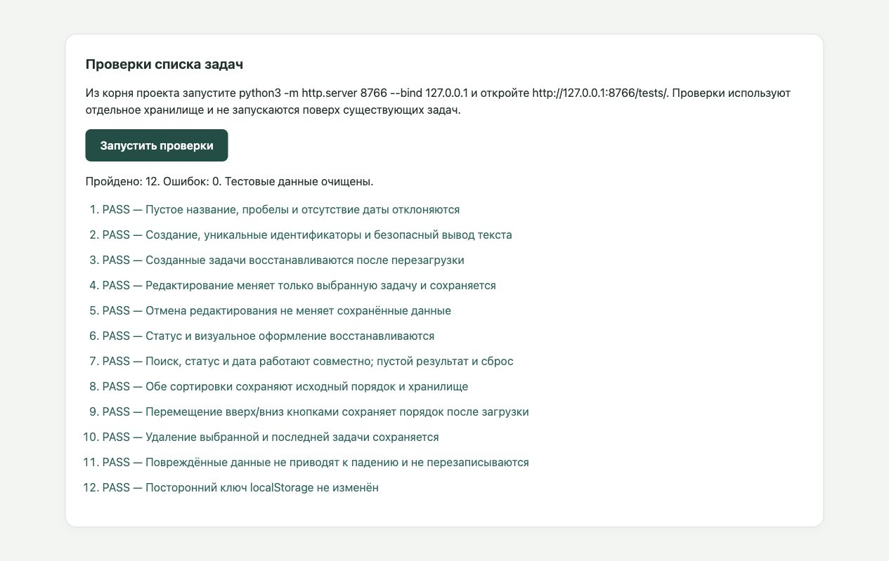

# Результаты проверок

Проверено 4 ноября 2026 года во встроенном браузере Codex.

## Повторный запуск

Из корня проекта:

```sh
python3 -m http.server 8766 --bind 127.0.0.1
```

Открыть [страницу проверок](http://127.0.0.1:8766/tests/) и нажать «Запустить проверки».
Node.js, установка пакетов и сторонние библиотеки не требуются.

Порт 8766 отделяет тестовое хранилище от приложения на порту 8765.
Если в хранилище тестового origin уже есть непустой список задач или тестовый служебный ключ,
запуск прекращается без изменения этих данных. После выполнения восстанавливается исходное
пустое состояние; удаляются только данные, созданные самим набором проверок.
Не запускайте несколько экземпляров набора одновременно на одном origin.

## Автоматизированные браузерные сценарии

Итоговый прогон: **12 пройдено, 0 ошибок**. Повторный запуск также завершился успешно.

Проверены:

- отклонение пустого названия, одних пробелов и отсутствующей даты;
- создание задач с одинаковыми названиями и разными идентификаторами, обрезка пробелов,
  буквальный вывод HTML-подобного текста;
- восстановление идентификаторов, дат и порядка после загрузки страницы приложения;
- редактирование выбранной задачи и сохранение новой даты и названия;
- отмена редактирования без изменения сохранённых данных;
- сохранение статуса выполнения и соответствующего оформления;
- одновременный поиск без учёта регистра, фильтры статуса и даты, пустой результат и сброс;
- сортировка по дате в обе стороны без изменения исходного порядка и localStorage;
- перемещение кнопками вверх/вниз и восстановление порядка;
- удаление выбранной и последней задачи с последующей загрузкой страницы;
- некорректный JSON, неверная структура, несуществующая дата, строковый статус и
  повторяющиеся идентификаторы: предупреждение без перезаписи исходного значения;
- сохранность постороннего ключа localStorage.

Перезагрузка в этих сценариях выполняется настоящим `location.reload()` внутри iframe
с полным повторным запуском приложения, а не заменой DOM тестовым кодом.



## Ручные проверки в браузере

- Перенос задачи мышью вниз и вверх за значок ⠿ изменяет порядок в ожидаемом направлении.
- После перезагрузки идентификаторы и порядок совпадают с результатом переноса.
- При ширинах viewport 320, 390, 768 и 1440 пикселей элементы помещаются по ширине,
  горизонтального переполнения нет. Использовалось в том числе название из 120 букв без пробелов.
- В консоли браузера при выполнении проверок не обнаружено ошибок и предупреждений JavaScript.

Проверки адаптивности выполнены изменением viewport; физический телефон и другие браузеры
в этом прогоне не использовались. Ошибок приложения, требующих исправления, этот этап не выявил.
Проверка опубликованного сайта относится к следующему этапу.
